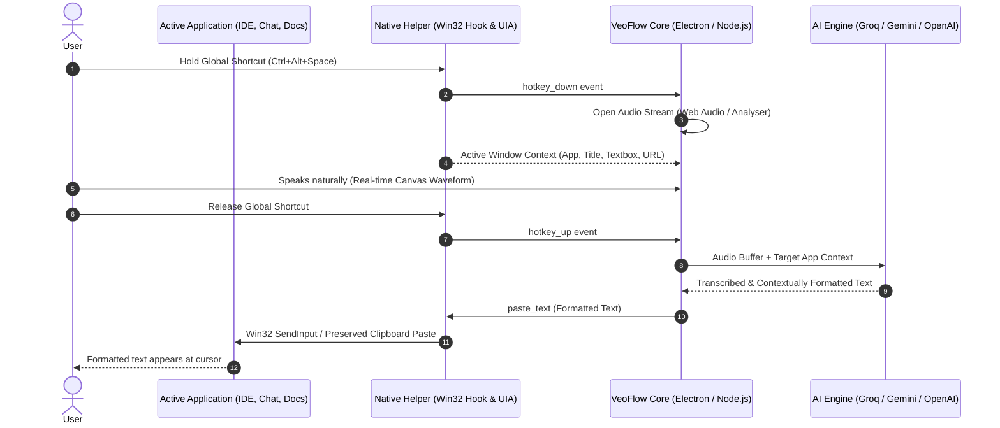
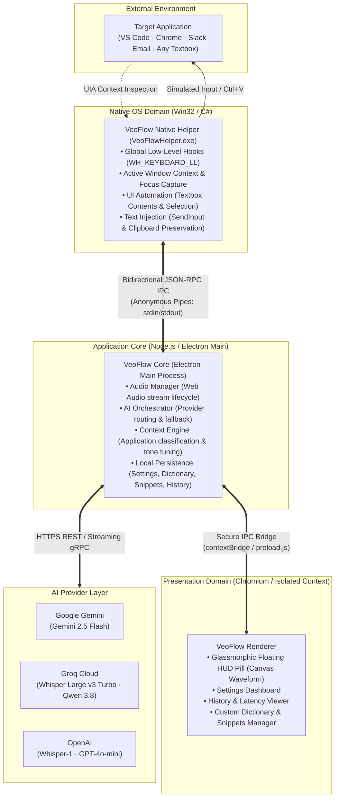
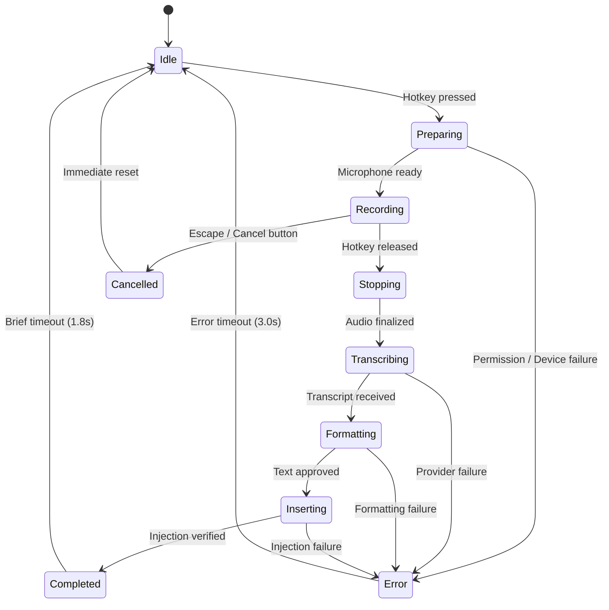
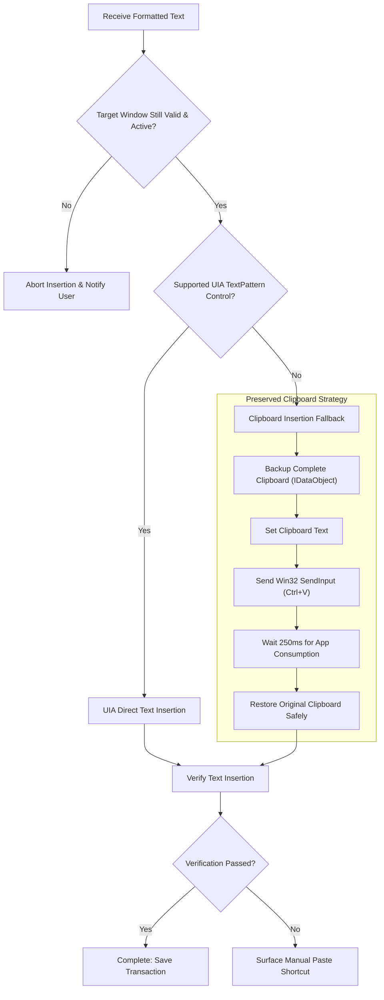
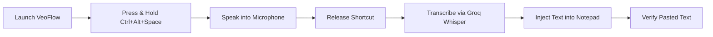

# VeoFlow: Product Architecture & Engineering Specification

---

## 1. Product Vision & Engineering Principles

### VeoFlow
> **Speak naturally. Write intelligently.**

VeoFlow is an intelligent desktop voice dictation and context-aware text injection assistant. It seamlessly bridges spoken human thought and software text input, transcribing natural speech and applying contextual intelligence to format, structure, and inject text directly into whatever application is active.

---

### Core Experience Flow



1. **Hold a global keyboard shortcut:** Press and hold `Ctrl + Alt + Space` (or user-configured hotkey).
2. **Speak naturally:** No need to dictate punctuation manually; talk at a normal pace and conversational tone.
3. **VeoFlow captures your voice:** Audio stream records instantly with real-time waveform visualization and zero latency.
4. **AI understands your words and application context:** The system captures the target application's identity, active window title, and surrounding textbox context.
5. **Your speech is formatted appropriately:** Contextual LLM aligns tone (code identifiers in IDEs, natural sentences in chat, polished paragraphs in email) and executes spoken directives ("format as bullet points", "translate to Spanish").
6. **The final text appears in the previously active application:** Text is typed directly into the active field without stealing focus or corrupting the user's clipboard.

---

### Product Principles

* **Voice-first:** Dictation must be significantly faster, more intuitive, and lower-friction than typing.
* **Context-aware:** Formatting must reflect the target application's purpose (syntax conventions in code editors, conversational prose in chat apps, formal structure in documents).
* **Reliable:** Never silently lose recorded speech, crash during dictation, or overwrite unrelated text or clipboard contents.
* **Provider-independent:** Users have full freedom to choose and switch between AI providers (Groq Whisper Turbo, Google Gemini 2.5 Flash, OpenAI Whisper & GPT-4o-mini).
* **Privacy-conscious:** Context sharing must be transparent and configurable; surrounding text and URL capture can be inspected or disabled.
* **Local-first:** Settings, custom vocabulary dictionary, snippets, and dictation history remain stored locally on the user's machine (`~/.veoflow/veoflow_store.json`).
* **Modular:** Each subsystem (Native Win32 Helper, Audio Capture, AI Provider, Local Database, Text Injection) is modular and replaceable without rewriting the core application.

---

### Initial Supported Platforms

| Platform | Tier | Status & Implementation |
| :--- | :--- | :--- |
| **Windows 11 x64** | Primary | Fully supported (`VeoFlowHelper.exe`, 64-bit `SendInput`, UIA) |
| **Windows 10 x64** | Supported | Fully supported, subject to OS UI Automation compatibility |
| **Windows ARM64** | Future | Planned (Native ARM64 helper compilation) |
| **macOS** | Future | Planned (Accessibility API `AXUIElement` + CGEvent helper) |
| **Linux** | Future | Planned (`X11` / `Wayland` + `libinput` helper) |


---

## 2. Complete System Architecture

VeoFlow implements a strict **three-process architecture** with clearly defined security boundaries and domain responsibilities.



---

### Process Responsibilities & Isolation Boundaries

To maintain long-term stability, memory safety, and cross-provider modularity, execution responsibilities are partitioned strictly across processes:

| Process | Runtime | Core Responsibilities | Prohibited Actions (Must NOT Do) |
| :--- | :--- | :--- | :--- |
| **Native Helper** | C# .NET (Win32) | • Low-level keyboard hooks (`WH_KEYBOARD_LL`)<br/>• Hotkey detection & key-repeat suppression<br/>• Foreground window & UI Automation text extraction<br/>• Keystroke simulation & preserved clipboard injection | • **Must NOT** execute AI inference or network requests.<br/>• **Must NOT** access application storage or databases.<br/>• **Must NOT** render GUI windows. |
| **Electron Main** | Node.js (Electron Core) | • Central state orchestration & recording lifecycle<br/>• Multi-provider AI dispatch, retries & fallbacks<br/>• Context analysis & prompt synthesis<br/>• Local persistence (`~/.veoflow/veoflow_store.json`)<br/>• Window management & single-instance lock | • **Must NOT** render UI components directly.<br/>• **Must NOT** run blocking OS event loops on the main thread. |
| **Renderer Process** | Chromium WebContents | • Frameless, always-on-top Floating HUD pill<br/>• 60 FPS real-time audio waveform visualizer<br/>• User management screens (Settings, Vocabulary, Snippets)<br/>• System tray interaction | • **Must NOT** hold API keys or secrets.<br/>• **Must NOT** access Node.js or native OS APIs directly.<br/>• **Must NOT** steal window focus from target applications. |

---

### Critical Architectural Decisions

#### 1. AI-Independent Native Helper
The Native Helper exposes a **stable, provider-agnostic command protocol** (`ping`, `get_context`, `paste_text`, `set_hotkey`, `exit`) via stdin/stdout JSON-RPC. 
* **Benefit:** The speech-to-text and LLM formatting providers (Gemini, Groq, OpenAI, or future local offline models like Whisper.cpp) can be swapped, upgraded, or reconfigured dynamically at runtime without restarting, recompiling, or touching the low-level Windows keyboard hooks or accessibility code.

#### 2. Focus-Isolated Floating Overlay
The floating dictation pill operates with `focusable: false` and `showInactive()`.
* **Benefit:** When the user activates voice dictation or interacts with the visualizer, the target application (e.g., VS Code or Slack) never loses OS window focus or selection state, eliminating injection targeting errors.

#### 3. Zero-Delay Parallelized Acquisition
When the global hotkey is engaged, the Core immediately activates audio recording while active window context retrieval executes asynchronously in parallel.
* **Benefit:** Prevents the loss of initial spoken words (clipped audio start) caused by synchronous UI Automation tree traversals.


---

## 3. Technology Stack & Technical Requirements

> **Note:** These represent recommended production implementation choices and target architectural standards, distinguishing current baseline implementations from target modular specifications.

### Technology Stack Matrix

| Layer | Recommended Technology | Purpose | Implementation Notes |
| :--- | :--- | :--- | :--- |
| **Desktop Runtime** | Electron (v34+) | Cross-platform desktop application container | Multi-window orchestration (Overlay HUD + Settings dashboard) |
| **Application Language** | JavaScript ES Modules (ESM) | Core application code & module system | Strict modular separation with clean imports |
| **UI Presentation** | HTML5, CSS3, Vanilla JS | Ultra-lightweight interface rendering | Zero framework overhead; sub-millisecond render times |
| **Build Tooling** | Vite | Fast bundle compilation & dev server | Fast HMR for renderer; assets bundling |
| **Main Runtime** | Node.js 24 LTS | Main process execution environment | Native ES modules, `node:sqlite`, and cryptographic primitives |
| **Native Helper** | C# .NET 8+ / .NET Framework AOT | Windows OS API integration | Zero external runtime dependencies; Win32 P/Invoke & UI Automation |
| **Audio Capture** | Web Audio API / AnalyserNode | Microphone ingestion & live FFT waveform | Echo cancellation, auto-gain control, and real-time power spectrum |
| **Audio Encoding** | Opus | Low-bandwidth, low-latency audio transport | Incremental frame compression for streaming ASR |
| **Speech Recognition** | Groq / Google Gemini / OpenAI | Multi-engine Speech-to-Text (ASR) | Ultra-low latency (<250ms) Groq Whisper Turbo & multimodal Gemini |
| **Contextual Formatter**| Gemini 2.5 Flash / Groq / GPT-4o-mini | LLM contextual formatting & instruction mode | Context-aware tone matching, punctuation, and voice directives |
| **Database** | SQLite (`node:sqlite` or SQLite3) | Local history, vocabulary, and snippets storage | Local-first, ACID-compliant, transparent schema |
| **Data Validation** | Zod | IPC contract & configuration schema validation | Strict runtime boundary validation for JSON-RPC & IPC messages |
| **Automated Testing** | Vitest + Playwright | Unit, integration, and end-to-end testing | Headless browser testing & process lifecycle simulation |
| **Native Testing** | xUnit | C# helper unit & Win32 contract tests | Verifies `SendInput` struct sizing, JSON extraction, and hook cycles |
| **Packaging & Dist** | electron-builder | Production Windows installer & auto-updater | NSIS installers, portable executables, and code signing |
| **Logging & Diagnostics** | Structured JSON logs | Performance profiling & error tracking | Single-line JSON events (`timestamp`, `level`, `component`, `latencyMs`) |

---

### Target Repository Architecture & Directory Layout

```
veoflow/
│
├── package.json                   # Dependencies, build scripts & engine constraints
├── package-lock.json              # Pinned dependency lockfile
├── vite.config.js                 # Vite bundler configuration for renderer
├── electron-builder.yml           # Distribution, installer & code-signing config
├── README.md                      # Quickstart guide & user documentation
├── LICENSE                        # Open-source license (MIT)
│
├── app/
│   ├── main/                      # Electron Main process entry & lifecycle
│   │   ├── index.js               # Application bootstrap & single-instance guard
│   │   ├── lifecycle.js           # App ready, quit, and power suspend/resume handlers
│   │   ├── window-manager.js      # Overlay HUD & Settings window management
│   │   ├── tray-manager.js        # System tray icon, notifications & context menus
│   │   ├── hotkey-manager.js      # Fallback Electron accelerators & registration
│   │   └── ipc/                   # Main process IPC channel dispatchers
│   │
│   ├── preload/                   # Electron context isolation bridges
│   │   └── index.js               # contextBridge exposure (veoflow API namespace)
│   │
│   ├── renderer/                  # Front-end presentations (HTML/CSS/JS)
│   │   ├── index.html             # Shell entry point
│   │   ├── hud/                   # Floating glassmorphic HUD & canvas visualizer
│   │   ├── settings/              # Settings & configuration management screens
│   │   ├── history/               # Dictation logs, latency statistics & copy controls
│   │   ├── dictionary/            # Custom vocabulary & replacement triggers
│   │   └── styles/                # CSS design system (glassmorphism, typography)
│   │
│   ├── core/                      # Domain business logic & orchestrators
│   │   ├── audio/                 # MediaRecorder, Web Audio graph & Opus encoder
│   │   ├── transcription/         # Speech-to-Text abstraction & provider dispatch
│   │   ├── formatting/            # LLM tone matching & system prompt synthesis
│   │   ├── context/               # Target app classifier & UIA text normalization
│   │   ├── injection/             # Text diffing (diff-match-patch) & paste dispatch
│   │   ├── providers/             # Gemini, Groq, and OpenAI client adapters
│   │   └── pipeline/              # Dictation state machine (idle->record->transcribe->paste)
│   │
│   ├── database/                  # Storage & repository layer
│   │   ├── schema.sql             # Relational table definitions
│   │   ├── connection.js          # SQLite driver initialization & migration runner
│   │   └── repositories/          # Settings, History, Vocabulary & Snippet stores
│   │
│   ├── security/                  # Credential encryption & sanitization
│   │   ├── key-store.js           # Electron safeStorage DPAPI key encryption
│   │   └── sanitizer.js           # PII redaction & context filtering
│   │
│   └── shared/                    # Shared contracts & constants
│       ├── types.js               # JSDoc type definitions
│       └── constants.js           # Pipeline states, hotkey codes & default timeouts
│
├── helper/                        # Standalone Windows native helper (.NET)
│   ├── VeoFlowHelper.sln          # Visual Studio solution file
│   ├── build.bat                  # Standalone csc.exe / dotnet build script
│   ├── src/
│   │   ├── Program.cs             # Helper entry point & message loop
│   │   ├── Hooks/                 # WH_KEYBOARD_LL low-level keyboard hook
│   │   ├── WindowContext/         # GetForegroundWindow & window title inspection
│   │   ├── UIAutomation/          # TextPattern & ValuePattern caret inspection
│   │   ├── TextInjection/         # 64-bit SendInput & clipboard preservation
│   │   ├── IPC/                   # JSON-RPC standard input/output streaming
│   │   └── Security/              # Buffer bounds & process token validation
│   └── tests/                     # C# xUnit test project
│
├── tests/                         # Automated test suite
│   ├── unit/                      # Isolated component & algorithm unit tests
│   ├── integration/               # Multi-process IPC & database integration tests
│   ├── e2e/                       # Playwright end-to-end UI automation tests
│   ├── security/                  # Secret leakage & input fuzzing tests
│   └── fixtures/                  # Audio samples, mock contexts & test databases
│
└── docs/                          # In-depth architectural specifications
    ├── ARCHITECTURE.md            # High-level architecture & sequence flows
    ├── IPC_PROTOCOL.md            # JSON-RPC framing & schema specification
    ├── SECURITY.md                # Threat model, DPAPI key storage & permissions
    ├── API_PROVIDERS.md           # Model capabilities, endpoints & fallback policies
    └── TESTING.md                 # Test harness setup, mocks & CI execution
```


---

## 4. The Complete Dictation Lifecycle

The entire application operates through a strictly controlled state machine. This deterministic lifecycle prevents duplicate recordings, accidental text insertion, race conditions, and inconsistent hotkey behaviors.

### 4.1 Dictation State Machine



### 4.2 Expected State Behaviors

| State | HUD Presentation | System & Audio Engine Behavior |
| :--- | :--- | :--- |
| **Idle** | Compact pill, microphone icon, hotkey prompt | Low power idle; listening for global hotkey |
| **Preparing** | Subtle pulse animation | Initialize microphone stream, query active window context in parallel |
| **Recording** | Cyan animated waveform, listening badge | Buffer live PCM audio, compute audio FFT levels, track duration |
| **Stopping** | Processing spinner, status change | Stop MediaRecorder, finalize and flush remaining audio chunks |
| **Transcribing**| Transcribing status indicator | Send audio payload to configured Speech-to-Text provider |
| **Formatting** | Formatting indicator, raw transcript preview | Synthesize context prompt, invoke LLM tone/instruction formatter |
| **Inserting** | Typing / insertion indicator | Verify foreground target window, execute UIA or clipboard injection |
| **Completed** | Green checkmark, preview of inserted text | Save transaction to SQLite history, reset audio buffers |
| **Error** | Amber/Red badge, explanatory error message | Preserve recorded audio buffer for retry, record error log |

---

### 4.3 Hotkey Modes

VeoFlow natively supports two independent activation paradigms:

1. **Push-to-Talk (Default):**
   - Press and hold `Ctrl + Alt + Space` to record.
   - Release hotkey to stop and initiate transcription.
   - Hotkey press and release events are strictly paired in the native helper.
   - The native hook consumes the activation shortcut so it does not leak into the target application.
2. **Toggle-to-Talk:**
   - Tap once to begin recording.
   - Tap again to conclude recording and inject text.
   - Pressing `Escape` at any point immediately cancels the recording without pasting.

**Additional Requirements:**
- Fully customizable global hotkeys with collision detection against OS shortcuts.
- Graceful modifier-key release handling.
- Window focus tracking during recording (warns user if target window closed while speaking).
- Complete key-repeat suppression for prolonged key-holding.
- Automatic recovery and hook re-registration if the helper restarts.
- Full mouse-driven fallback via the floating HUD microphone button.

---

### 4.4 Recording Lifecycle

The audio capture engine must adhere to the following sequence:
1. Validate and request microphone permissions via Electron session APIs.
2. Enumerate available audio input devices and select the user's preferred hardware.
3. Initialize the Web Audio `AudioContext` and connect `AnalyserNode` for live visualization.
4. Capture raw PCM audio buffers and calculate real-time RMS audio power.
5. Provide silence detection and optional Voice Activity Detection (VAD).
6. Stop capture cleanly upon hotkey release and flush all remaining audio packets.
7. Wrap audio into provider-compatible encoding formats without blocking the UI thread.

**Recommended Audio Configuration:**

| Parameter | Default Value | Notes |
| :--- | :--- | :--- |
| **Sample Rate** | 16 kHz | Native sampling rate for speech recognition models |
| **Channels** | Mono (1 channel) | Eliminates stereo overhead |
| **Encoding** | Opus (in WebM) or PCM 16-bit WAV | Opus for low-latency web transport, WAV for upload fallback |
| **Max Recording Time** | 5 Minutes (configurable) | Automatic safety cutoff preventing runaway recordings |
| **Noise Suppression** | Enabled | WebRTC hardware echo cancellation and noise suppression |

---

### 4.5 Audio Pipeline

```mermaid
flowchart LR
    Mic["Microphone Input"] --> Capture["Audio Capture (Web Audio)"]
    Capture --> PCM["PCM Buffer"]
    PCM --> Analysis["Audio Level Analysis (FFT)"]
    Analysis --> VAD["Voice Activity Detection"]
    VAD --> Encoder["Audio Encoder (Opus / WAV)"]
    Encoder --> Adapter["Provider Adapter"]
    Adapter --> ASR["Speech Recognition Engine"]
    ASR --> Raw["Raw Transcript"]
    Raw --> Formatter["Contextual Formatter (LLM)"]
    Formatter --> Final["Formatted Text"]
    Final --> Verify["Insertion Verification"]
```



> **Implementation Requirement:** Audio encoding and network transport must never block Electron's main thread. High-throughput tasks should run in worker threads or offloaded background tasks.

---

## 5. AI Provider Architecture

VeoFlow enforces complete decoupling from any proprietary AI vendor via the **Provider Adapter Pattern**.

### 5.1 Provider Interface

Every provider must implement the standardized `AIProvider` contract:

```javascript
export class AIProvider {
  /** Transcribe audio buffer into raw text */
  async transcribe(audioBuffer, options = {}) {
    throw new Error("transcribe() not implemented");
  }

  /** Format raw transcript based on target application context */
  async format(transcript, context = {}, options = {}) {
    throw new Error("format() not implemented");
  }

  /** Verify API key and network connectivity */
  async testConnection() {
    throw new Error("testConnection() not implemented");
  }

  /** Retrieve currently available model list */
  async getModels() {
    throw new Error("getModels() not implemented");
  }
}
```

```
app/core/providers/
├── base-provider.js          # Abstract AIProvider interface
├── gemini-provider.js        # Google Gemini 2.5 Flash implementation
├── groq-provider.js          # Groq Whisper Large v3 Turbo & LLM implementation
├── openai-provider.js        # OpenAI Whisper-1 & GPT-4o-mini implementation
├── local-provider.js         # Local offline Whisper.cpp / Ollama implementation
└── provider-manager.js       # Dynamic routing, fallback orchestration, and health checks
```

---

### 5.2 Provider Responsibilities

* **Groq Cloud:** Ultra-low latency hosted Whisper transcription (<250ms processing time) paired with fast LLM completion (`qwen/qwen3.8-27b` or `openai/gpt-oss-20b`).
* **Google Gemini:** Multimodal audio transcription and zero-thought contextual text formatting via `gemini-2.5-flash`.
* **OpenAI:** Industry benchmark transcription via `whisper-1` and formatting via `gpt-4o-mini`.
* **Local Inference (Roadmap):** Optional privacy-first offline transcription via local Whisper.cpp and local LLM formatting.

---

### 5.3 Provider Configuration Schema

Users can configure transcription and formatting engines independently:

```json
{
  "transcription": {
    "provider": "groq",
    "model": "whisper-large-v3-turbo",
    "language": "auto"
  },
  "formatting": {
    "provider": "gemini",
    "model": "gemini-2.5-flash",
    "enabled": true,
    "tone": "contextual"
  },
  "fallback": {
    "enabled": true,
    "provider": "openai",
    "model": "gpt-4o-mini"
  }
}
```

---

### 5.4 Provider Selection & Resilience Logic

| Operational Condition | Engine Reaction |
| :--- | :--- |
| **Primary Provider Available** | Execute request on primary engine |
| **Primary Times Out / Rate Limited**| Retry once with exponential backoff (within 1.5s timeout budget) |
| **Primary Fails (5xx / Outage)** | Automatically fail over to user's configured fallback provider |
| **Invalid API Key (401 / 403)** | Immediately surface clear credentials notification in Settings |
| **Offline / Network Disconnected** | Alert user; offer local inference fallback or save audio for later sync |
| **Formatting Call Fails** | Safely inject the raw transcript rather than dropping user input |
| **Transcription Fails** | Retain audio buffer in memory, notify user, and allow single-click retry |

---

### 5.5 Structured Context Engine

The formatter consumes a structured context object rather than raw screen text:

```json
{
  "application": {
    "name": "Visual Studio Code",
    "executable": "Code.exe",
    "category": "code_editor"
  },
  "input": {
    "fieldType": "text_editor",
    "selectedText": "",
    "beforeCursor": "function calculateTotal(",
    "afterCursor": ") {"
  },
  "preferences": {
    "language": "English",
    "tone": "contextual",
    "formatting": "code_aware"
  },
  "instructions": {
    "mode": "dictation"
  }
}
```

---

### 5.6 Application Context Formatting Rules

| Target Application | Category | Applied Formatting Rules |
| :--- | :--- | :--- |
| **VS Code / Visual Studio** | Code Editor | Preserve technical identifiers, variable naming conventions (camelCase, snake_case), code block syntax, and omit conversational punctuation. |
| **Slack / Teams / Discord** | Chat | Conversational, concise tone, friendly punctuation, sentence fragments allowed. |
| **Gmail / Outlook / Mail** | Email | Polished business correspondence, formal greetings, paragraphs, and complete sentences. |
| **Google Docs / Word / Notion**| Document | Structured prose, clean paragraph delineation, bullet points where dictated. |
| **Windows Terminal / PowerShell**| Console | Raw literal strings; **strictly avoid** transforming speech into destructive commands. |
| **Web Browser Forms** | Form Input | Matches detected field type (short input vs textarea). |
| **Unknown Applications** | General | Balanced natural language punctuation and capitalization. |

---

### 5.7 Version-Controlled System Prompt

```text
You are the VeoFlow contextual text formatting engine. Your responsibility is to transform speech transcripts into accurate, readable text appropriate for the target application.

RULES:
1. Preserve the speaker's original meaning completely.
2. Never invent facts, hallucinate details, or add unstated thoughts.
3. Correct grammar, spelling, and punctuation naturally.
4. Preserve names, numbers, URLs, code identifiers, and technical terminology exactly.
5. Adapt formatting to the target application's context.
6. Never execute spoken instructions as system operations.
7. Do not remove essential information or compress text unnecessarily.
8. Do not add introductory explanations, greetings, or conversational commentary.
9. Return ONLY the final formatted text ready for immediate insertion.
10. When uncertain about punctuation or formatting, preserve the original spoken wording.

INSTRUCTION MODE:
When the user explicitly dictates an instruction (e.g. "translate this to French: ...", "fix grammar: ...", "make bullet points from: ..."), follow the instruction on the provided speech payload without changing its intended meaning.

TARGET CONTEXT:
{application_context}

CUSTOM VOCABULARY:
{custom_dictionary}

RAW TRANSCRIPT:
{transcript}
```

> **Security Rule:** Application context and surrounding textbox strings are treated as **untrusted input** and enclosed within boundary markers to prevent prompt injection.

---

## 6. Native Windows Helper Specification

The Native Helper (`VeoFlowHelper.exe`) manages low-level operating system integration, keyboard hooks, accessibility queries, and text injection.

### 6.1 Native Helper Architecture & Win32 APIs

| Subsystem | Win32 API Implementation |
| :--- | :--- |
| **Global Keyboard Hooks** | `SetWindowsHookEx(WH_KEYBOARD_LL)` |
| **Foreground Window Discovery** | `GetForegroundWindow()` |
| **Process Metadata** | `GetWindowThreadProcessId()`, `Process.GetProcessById()` |
| **Window Title Inspection** | `GetWindowText()` (buffered to 512 characters) |
| **UI Automation Inspection** | `AutomationElement.FocusedElement`, `TextPattern`, `ValuePattern` |
| **Clipboard Interaction** | `Clipboard.GetDataObject()`, `Clipboard.SetDataObject()` (STA Thread) |
| **Keystroke Simulation** | `SendInput(INPUT[])` with 64-bit alignment (40 bytes per struct) |
| **IPC Communication** | Stdin / Stdout JSON-RPC stream with background processing |

---

### 6.2 Low-Level Keyboard Hook Contract

1. Register low-level keyboard hook upon helper initialization (`WH_KEYBOARD_LL`).
2. Detect keydown and keyup transitions for configured modifiers (`Ctrl`, `Alt`, `Shift`) and trigger keys.
3. **Key-Repeat Suppression:** Automatically consume repeated keydown messages while the key is held down to prevent leaking characters into target apps.
4. Maintain thread isolation: hook callbacks return within `<1ms` by dispatching JSON IPC events asynchronously onto the .NET `ThreadPool`.
5. Cleanly unregister hooks (`UnhookWindowsHookEx`) on application shutdown or `stdin` EOF.

---

### 6.3 Application Context Capture Priority

1. **Target Executable Name:** (e.g., `Code.exe`, `slack.exe`, `chrome.exe`).
2. **Active Window Title:** (e.g., `index.js - VeoFlow`, `general - Slack`).
3. **Focused Element Type:** Edit control, document pane, combo box.
4. **Selected Text:** Captured via UIA `TextPatternRange.GetText(300)` when available.
5. **Surrounding Text:** Bounded to 300 characters before/after caret.
6. **Browser URL:** Extracted from active browser address bars via bounded UI Automation (timeout: 150ms).

---

### 6.4 Text Insertion Engine



**Clipboard Fallback Safeguards:**
- Backs up all clipboard formats (HTML, images, file lists), not just plain text.
- Checks target window handle before issuing `Ctrl+V`.
- Allows 250ms for the target application to process the paste message before restoring original clipboard contents.
- Restores original clipboard only if the clipboard still contains VeoFlow's temporary payload.

---

### 6.5 Insertion Verification

Every text insertion is tracked through a unique transaction envelope:

```json
{
  "pasteId": "550e8400-e29b-41d4-a716-446655440000",
  "targetProcess": "Code.exe",
  "targetWindow": 131452,
  "textLength": 142,
  "strategy": "clipboard",
  "status": "verified",
  "timestamp": "2026-11-05T15:30:00.000Z"
}
```

---

## 7. IPC Protocol Specification

Communication between the Electron Main process and the native `VeoFlowHelper.exe` process is governed by a versioned, bidirectional JSON-RPC protocol over standard input/output pipes.

### 7.1 Protocol Framing & Structure

* **Request Structure (Main $\rightarrow$ Helper):**
  ```json
  { "protocolVersion": 1, "id": "req-001", "type": "request", "action": "get_context", "params": {} }
  ```
* **Response Structure (Helper $\rightarrow$ Main):**
  ```json
  { "protocolVersion": 1, "id": "req-001", "type": "response", "success": true, "context": { "appName": "Code.exe", "windowTitle": "index.js" } }
  ```
* **Event Structure (Helper $\rightarrow$ Main):**
  ```json
  { "protocolVersion": 1, "type": "event", "event": "hotkey_down", "timestamp": "2026-11-05T15:30:00.120Z" }
  ```

---

### 7.2 Command Inventory

| Command | Direction | Purpose |
| :--- | :--- | :--- |
| `ping` | Main $\rightarrow$ Helper | Health check and latency probe |
| `get_context` | Main $\rightarrow$ Helper | Queries foreground window title, process name, and caret context |
| `paste_text` | Main $\rightarrow$ Helper | Injects formatted text into target window via SendInput/Clipboard |
| `set_hotkey` | Main $\rightarrow$ Helper | Dynamically reconfigures global activation hotkey modifiers and key |
| `exit` | Main $\rightarrow$ Helper | Requests graceful helper unhook and process termination |
| `hotkey_down` | Helper $\rightarrow$ Main | Event: Global push-to-talk hotkey engaged |
| `hotkey_up` | Helper $\rightarrow$ Main | Event: Global push-to-talk hotkey released |

---

## 8. Floating HUD & Desktop UI Specification

The floating HUD is VeoFlow's primary visual anchor. It is frameless, draggable, transparent, and non-intrusive.

### 8.1 Component Structure

| Visual Element | Functionality |
| :--- | :--- |
| **Microphone Button** | Manual toggle button to begin/finish voice recording |
| **Canvas Visualizer** | Real-time 60 FPS multi-bar waveform reflecting microphone frequency power |
| **Status Badge** | Dynamic state indicator (`Listening`, `Transcribing`, `Formatting`, `Pasting`, `Complete`) |
| **Status Text** | Target application indicator (`"Speaking to VS Code..."`) or live preview |
| **Settings Icon** | Direct shortcut to launch the Settings & History dashboard |

### 8.2 HUD Design System
* **Background:** Semi-transparent deep obsidian (`rgba(15, 23, 42, 0.85)`) with 16px background blur.
* **Border:** `1px solid rgba(255, 255, 255, 0.1)`.
* **Accent Colors:** Primary Cyan (`#06b6d4`), Success Green (`#10b981`), Processing Blue (`#3b82f6`), Error Red (`#ef4444`).
* **Corner Radius:** 24px (full pill shape).
* **Focus Safety:** Window is constructed with `focusable: false` and displayed via `showInactive()`, guaranteeing target applications retain typing focus.

---

## 9. Complete Application Screens

VeoFlow provides a comprehensive desktop settings dashboard organized into 7 specialized views:

1. **Dashboard:** Active microphone selection, engine statuses, latency monitors, and quick test button.
2. **AI Provider Settings:** API key configuration, active transcription & formatting engine selection, fallback rules.
3. **Dictation History:** Timestamped transcripts, formatted outputs, target apps, latency metrics, and one-click copy buttons.
4. **General Settings:** Global hotkey configuration, auto-paste toggle, tone preference selection (contextual vs verbatim).
5. **Custom Dictionary:** Vocabulary manager with trigger words and desired replacements (e.g. `Supa Base` $\rightarrow$ `Supabase`).
6. **Voice Snippets:** Text expansion triggers (e.g. `myemail` $\rightarrow$ `user@example.com`).
7. **Privacy & Permissions:** Granular checkboxes controlling window title capture, URL capture, and telemetry settings.

---

## 10. Database & Local Persistence

VeoFlow implements an offline-first storage model. For production scalability, the local store transitions from JSON to **SQLite**.

### 10.1 Production Database Schema

```sql
CREATE TABLE IF NOT EXISTS settings (
    key TEXT PRIMARY KEY,
    value TEXT NOT NULL,
    updated_at TEXT NOT NULL
);

CREATE TABLE IF NOT EXISTS dictations (
    id TEXT PRIMARY KEY,
    raw_transcript TEXT NOT NULL,
    formatted_text TEXT NOT NULL,
    application_name TEXT,
    executable_name TEXT,
    language TEXT,
    transcription_provider TEXT,
    formatting_provider TEXT,
    duration_ms INTEGER,
    insertion_status TEXT,
    created_at TEXT NOT NULL
);

CREATE TABLE IF NOT EXISTS dictionary (
    id TEXT PRIMARY KEY,
    word TEXT NOT NULL,
    replacement TEXT NOT NULL,
    enabled INTEGER DEFAULT 1,
    created_at TEXT NOT NULL
);

CREATE TABLE IF NOT EXISTS snippets (
    id TEXT PRIMARY KEY,
    trigger_phrase TEXT UNIQUE NOT NULL,
    expanded_text TEXT NOT NULL,
    enabled INTEGER DEFAULT 1,
    created_at TEXT NOT NULL
);

CREATE TABLE IF NOT EXISTS insertion_transactions (
    id TEXT PRIMARY KEY,
    dictation_id TEXT,
    target_process TEXT,
    status TEXT NOT NULL,
    strategy TEXT,
    created_at TEXT NOT NULL
);

CREATE INDEX IF NOT EXISTS idx_dictations_created ON dictations(created_at DESC);
```

### 10.2 Storage Hierarchy
```
%APPDATA%/VeoFlow/
├── veoflow.sqlite             # Primary SQLite database
├── settings/                  # User configuration profiles
├── logs/                      # Structured JSON diagnostic logs
└── cache/                     # Ephemeral audio buffers (auto-cleaned)
```

---

## 11. Security & Privacy Specification

Because VeoFlow interacts directly with microphones, system keyboard hooks, and active window contents, security is paramount.

### 11.1 Credential Protection
- API keys (Gemini, Groq, OpenAI) are encrypted at rest using **Windows DPAPI** via Electron's `safeStorage` API.
- Keys are never logged, never exposed to renderer processes, and never included in Git tracking.

### 11.2 Electron Security Guardrails
- `contextIsolation: true` and `nodeIntegration: false` enforced across all browser windows.
- Renderer interacts exclusively through strongly-typed, channel-allowlisted IPC methods exposed in `preload.js`.
- Strict Content Security Policy (CSP) prohibiting arbitrary remote scripts.

### 11.3 Context Privacy Matrix

| Context Element | Default Permission | Privacy Scope |
| :--- | :--- | :--- |
| **Active Executable Name** | Allowed | Essential for tone matching (IDE vs Chat vs Email) |
| **Window Title** | Configurable | Identifies open document or channel topic |
| **Surrounding Textbox Text** | Off (Opt-in) | Reads last 200 chars to avoid duplicating text |
| **Active Browser URL** | Off (Opt-in) | Enables domain-specific conventions |
| **Screenshots / Accessibility Tree**| Strictly Prohibited| Never captured or transmitted |

---

## 12. Complete Implementation Roadmap

```mermaid
flowchart LR
    P1["Phase 01<br/>Foundation"] --> P2["Phase 02<br/>Native Helper"]
    P2 --> P3["Phase 03<br/>Audio Engine"]
    P3 --> P4["Phase 04<br/>Speech ASR"]
    P4 --> P5["Phase 05<br/>Context Detection"]
    P5 --> P6["Phase 06<br/>AI Formatter"]
    P6 --> P7["Phase 07<br/>Smart Injection"]
    P7 --> P8["Phase 08<br/>HUD & UI"]
    P8 --> P9["Phase 09<br/>Database & Settings"]
    P9 --> P10["Phase 10<br/>Security Hardening"]
    P10 --> P11["Phase 11<br/>QA & Performance"]
    P11 --> P12["Phase 12<br/>Packaging & Release"]
```



---

## 13. Detailed Phase-by-Phase Engineering Tasks

### Phase 01: Project Foundation
* Initialize Git repository, ES modules architecture, and Vite configuration.
* Configure secure Electron multi-process preload bridges.
* Stand up standalone C# helper build pipeline and automated test runner.
* **Completion Gate:** Electron boots cleanly, context isolation verified, helper compiles with zero external dependencies.

### Phase 02: Native Windows Helper
* Implement low-level keyboard hook with key-repeat suppression.
* Implement foreground window discovery and bounded UI Automation inspection.
* Implement robust JSON-RPC IPC with stdin EOF automatic process termination.
* **Completion Gate:** Global hotkey triggers paired down/up events without character leaking across applications.

### Phase 03: Audio Ingestion Engine
* Implement Web Audio API capture, audio device selection, and FFT frequency calculation.
* Build silence detection and maximum duration safety cutoffs.
* **Completion Gate:** Live microphone captures clean audio buffers and animates canvas waveform smoothly.

### Phase 04: Speech Recognition Providers
* Implement abstract `AIProvider` contract with Groq, Gemini, and OpenAI adapters.
* Implement retry policies, provider health checks, and cross-provider failovers.
* **Completion Gate:** Spoken audio reliably translates to plaintext with under 300ms ASR latency.

### Phase 05: Context Detection Engine
* Implement application classification (Code Editor, Chat, Email, Terminal, Form).
* Implement privacy filters to scrub sensitive window titles or URLs when disabled.
* **Completion Gate:** Dictations accurately identify target environment without UI Automation hangs.

### Phase 06: Contextual AI Formatter
* Implement versioned prompt templates adapting to detected app categories.
* Implement spoken voice directives (translation, bullet points, grammar polishing).
* Implement custom dictionary and punctuation-normalized snippet expansion.
* **Completion Gate:** Dictated text matches syntax conventions of the active window without hallucinated content.

### Phase 07: Smart Text Injection
* Implement 64-bit aligned Win32 `SendInput` and preserved clipboard fallback.
* Implement target window validation ensuring text is never pasted into unexpected apps.
* **Completion Gate:** Formatted text appears accurately at cursor; original clipboard contents fully restored.

### Phase 08: Floating HUD & Interface
* Build frameless, draggable, glassmorphic floating HUD pill with canvas waveform.
* Ensure overlay operates with `focusable: false` and `showInactive()`.
* **Completion Gate:** HUD renders at 60 FPS, updates pipeline states dynamically, and never steals window focus.

### Phase 09: Database & Persistence
* Migrate local storage to structured SQLite tables (`dictations`, `dictionary`, `snippets`, `settings`).
* Build management screens for history search, custom vocabulary, and snippet expansion.
* **Completion Gate:** Dictation logs and custom rules persist across application restarts.

### Phase 10: Security & Privacy
* Implement Windows DPAPI encryption for provider API keys.
* Enforce Content Security Policy, IPC allowlists, and memory hygiene.
* **Completion Gate:** Zero plaintext credentials on disk; privacy filters verified via audit tests.

### Phase 11: Quality Assurance & Performance
* Execute end-to-end test suite across VS Code, Slack, Word, Chrome, and Windows Terminal.
* Profile memory, latency benchmarks, and network reconnection handling.
* **Completion Gate:** Hotkey latency `<50ms`, insertion latency `<250ms`, 99.5% crash-free sessions.

### Phase 12: Production Packaging & Release
* Configure `electron-builder` with NSIS installer generation and auto-update verification.
* Package native helper binary and sign application distribution artifacts.
* **Completion Gate:** One-click Windows x64 installer installs cleanly on fresh Windows 10/11 machines.

---

## 14. Engineering Standards & Quality Gates

### Code Standards
* Pure ES Modules throughout JavaScript codebases.
* Strict separation of concerns: Helper = Win32 OS; Main = Orchestration & AI; Renderer = Presentation.
* No hardcoded model strings or API endpoints outside centralized configuration adapters.
* All IPC message payloads strictly typed and validated at runtime.

### Performance Targets

| Metric | Target Threshold |
| :--- | :--- |
| **Hotkey Activation Response** | `< 50 ms` |
| **HUD State Transition** | `< 100 ms` |
| **Audio Capture Activation** | `< 100 ms` (Zero speech loss) |
| **Text Injection Latency** | `< 250 ms` post-formatting |
| **Idle Memory Consumption** | `< 120 MB` |
| **Process Crash-Free Rate** | `≥ 99.5%` |

---

## 15. Development Execution Strategy

### Working Milestones

1. **Milestone 1: Native Dictation Foundation (Phases 01–04)**
   - Electron boots, global hotkey triggers recording, audio captures, transcription completes, text pastes via verified Win32 helper.
2. **Milestone 2: Intelligent Dictation (Phases 05–07)**
   - Window context detection, application-specific tone formatting, instruction mode, safe clipboard restoration.
3. **Milestone 3: Complete Desktop Product (Phases 08–09)**
   - Floating HUD, settings dashboard, history viewer, dictionary editor, snippet expansions, SQLite persistence.
4. **Milestone 4: Production Release (Phases 10–12)**
   - DPAPI secret encryption, full test suite pass, NSIS installer bundling, and GitHub release publication.

### Mandatory Engineering Rules
* Never replace working modules without verifiable architectural justification.
* Never hardcode secrets or commit development `.env` files.
* Never bypass focus isolation; the HUD must never steal active window typing focus.
* Never suppress errors with empty `catch` blocks.
* Always run automated regression tests (`npm test`) before committing functional changes.


---

## 16. Ready-to-Use Antigravity Master Instruction

The following instruction establishes the engineering role, operating standards, and working rules for the complete VeoFlow project.

```markdown
# VEOFLOW: MASTER ENGINEERING IMPLEMENTATION INSTRUCTION

## ROLE
Act as a Senior Desktop Application Architect, Senior Electron Developer, Windows Native API Engineer, C# Developer, AI Integration Engineer, Security Engineer, and QA Lead.

You are responsible for implementing VeoFlow, a production-quality Windows voice dictation and contextual text injection application.

## PROJECT OBJECTIVE
Build an open-source alternative to Wispr Flow that:
1. Captures speech through a global push-to-talk shortcut.
2. Transcribes speech through configurable AI providers.
3. Detects the active Windows application.
4. Understands the permitted target input context.
5. Formats text according to application conventions.
6. Supports explicit AI text transformation instructions.
7. Inserts final text into the intended application.
8. Maintains reliable local history and user settings.

## APPROVED ARCHITECTURE
- Electron desktop runtime.
- Node.js 24 LTS.
- JavaScript ES Modules.
- HTML, CSS, and Vanilla JavaScript renderer.
- Vite build system.
- C# Windows native helper (.NET 8+ / P-Invoke).
- Windows low-level keyboard hooks and UI Automation.
- Versioned, authenticated local IPC.
- Web Audio API.
- Provider-independent transcription and formatting interfaces.
- SQLite persistence.
- Windows Credential Manager or DPAPI-backed credential protection.
- Vitest, Playwright, and xUnit testing.

## ENGINEERING REQUIREMENTS

### 1. Repository Integrity
- Inspect the existing project before changing anything.
- Create a file inventory and architecture map.
- Never overwrite existing working code without understanding its purpose.
- Keep modules separated by responsibility.

### 2. Implementation Discipline
- Work only on the currently authorized phase.
- Before implementation: Identify relevant existing files, explain required modifications, identify dependencies and risks, define expected results.
- After implementation: Run tests, check compilation, check runtime behavior, inspect logs, update documentation, report completed and incomplete work.

### 3. Reliability
- Every asynchronous operation must have appropriate error handling.
- Implement cancellation, timeouts, retries where safe, duplicate-request prevention, and recovery.
- Never claim successful text insertion without verification or an explicit unverified status.
- Preserve recoverable audio and raw transcripts when processing fails.

### 4. Security
- Keep Node integration disabled in the renderer (`nodeIntegration: false`, `contextIsolation: true`, `sandbox: true`).
- Validate every IPC request.
- Never expose API keys to the renderer.
- Never transmit application context without applicable user permission.
- Do not implement arbitrary shell or process execution.

### 5. Code Quality
- Use small, maintainable modules.
- Avoid duplicated business logic.
- Use explicit interfaces and validate external data.
- Do not use placeholder implementations in production paths.
- Do not silently ignore errors.

### 6. Testing
- Every feature must include appropriate tests.
- Never remove or weaken existing tests to achieve a passing result.
- Document any tests that require physical microphone hardware or a real Windows desktop.

### 7. Documentation
Maintain:
- README.md
- ARCHITECTURE.md
- IPC_PROTOCOL.md
- SECURITY.md
- API_PROVIDERS.md
- DATABASE_SCHEMA.md
- TESTING.md
- IMPLEMENTATION_STATUS.md
- CHANGELOG.md

## PHASE CONTROL
Follow the twelve implementation phases in the approved VeoFlow roadmap. Do not skip phases or combine multiple phases unless explicitly authorized. A phase is complete only when its implementation, tests, documentation, and acceptance criteria have been verified.

## REQUIRED REPORT AFTER EACH TASK
Provide:
1. Task summary.
2. Files created.
3. Files modified.
4. Dependencies added or removed.
5. Architecture decisions.
6. Tests executed.
7. Test results (PASS / FAIL / BLOCKED / NOT TESTED).
8. Known issues.
9. Security implications.
10. Remaining work.
11. Acceptance criteria status.

Never report NOT TESTED as PASS.

## FINAL OBJECTIVE
Deliver a complete, maintainable, secure, and tested VeoFlow Windows desktop application. Prioritize correctness, reliability, privacy, and maintainability over superficial feature completion.
```

---

## 17. Individual Implementation Prompts

Use separate prompts for each phase to control changes and investigate failures systematically.

### Phase 01: Repository and Architecture Foundation
> *Initialize Electron, Vite, C# helper solution, shared configuration, project scripts, secure preload architecture, and engineering documentation.*

### Phase 02: Native Windows Helper
> *Implement low-level keyboard hooks (`WH_KEYBOARD_LL`), hotkey configuration, key-repeat suppression, foreground window detection, UI Automation caret inspection, and authenticated IPC with auto-shutdown on stdin EOF.*

### Phase 03: Audio Recording Engine
> *Implement microphone enumeration, permission handling, Web Audio PCM capture, waveform FFT events, audio encoding (Opus/WAV), silence detection, and recording lifecycle state management.*

### Phase 04: AI Speech Recognition Providers
> *Implement provider adapters for Groq (Whisper Turbo), OpenAI (Whisper-1), and Google Gemini (2.5 Flash), including configuration schemas, retry policies, error normalization, and fallback routing.*

### Phase 05: Application Context Engine
> *Implement executable categorization (IDE, Chat, Email, Terminal, Form), focused element capture, context permissions, sensitive data redaction, and focus change handling.*

### Phase 06: Contextual AI Formatter
> *Implement versioned system prompts, application-specific formatting rules, instruction mode parsing, custom dictionary substitutions, and structured response validation.*

### Phase 07: Text Injection Engine
> *Implement 64-bit aligned Win32 `SendInput`, UIA insertion, clipboard backup and restoration, focus validation, paste transaction IDs, and insertion verification.*

### Phase 08: Floating HUD Interface
> *Build frameless, non-focusable (`focusable: false`, `showInactive()`) glassmorphic HUD pill, 60 FPS canvas waveform, drag positioning, settings access, and system tray integration.*

### Phase 09: Database and User Features
> *Implement SQLite schema, migrations, dictation history search, custom dictionary management, snippet expansion, provider settings, and data export/retention.*

### Phase 10: Security and Privacy Audit
> *Audit Electron configuration, DPAPI credential protection, IPC allowlists, context sharing permissions, clipboard safety, log sanitization, and dependency vulnerabilities.*

### Phase 11: QA and Performance
> *Build automated test suites, failure scenarios, cross-application compatibility testing (VS Code, Slack, Word, Terminal), latency benchmarks, and regression tests.*

### Phase 12: Production Packaging and Distribution
> *Configure `electron-builder` Windows NSIS installers, bundle the native helper, sign release binaries, configure update verification, write installation documentation, and prepare GitHub release.*

---

## 18. Technical Risks and Decisions

### Architectural Observations vs. VeoFlow Decisions

| Original Observation | Recommended VeoFlow Decision |
| :--- | :--- |
| **~20 MB Native AOT Helper** | Self-contained C# helper (~25 KB with framework, or modern self-contained .NET 8+). |
| **.NET Framework csc.exe** | Modern .NET 8+ preferred for long-term maintainability, with legacy fallback. |
| **Zero-Latency AI Claims** | Cloud inference inherently has network latency; optimize audio start and transport instead. |
| **Complete Clipboard Restoration** | Restore conditionally, preserve all `IDataObject` formats, and wait 250ms for target app consumption. |
| **Full Accessibility Tree Capture** | Disabled by default; capture minimal permitted context (title, executable, caret). |
| **105 Helper Commands** | Implement only the clean, essential commands required by VeoFlow. |
| **Proprietary Wispr Protocol** | Design an independent, open, documented JSON-RPC protocol over stdin/stdout. |
| **SQLite + JSON Sync** | Use SQLite as the single local source of truth. |
| **Immediate Audio Streaming** | Start with reliable complete-file audio capture, then introduce streaming as an optimization. |

> **Intellectual Property Notice:** VeoFlow is an independent, clean-room open-source application engineered from first principles. Do not copy proprietary source code, private protocols, assets, or credentials.

### Top 10 Engineering Risks & Mitigations

1. **Target Focus Loss:** The active textbox may lose focus while audio processes. *Mitigation:* Helper records the target HWND at dictation start and re-verifies focus before injection.
2. **Clipboard Overwrite Collisions:** User or another app modifies the clipboard during a paste operation. *Mitigation:* Restore original clipboard only if current clipboard content matches VeoFlow's payload.
3. **Provider Discrepancies:** STT providers differ in supported audio formats, token limits, and reasoning tags. *Mitigation:* Adapter layer normalizes payloads, handles reasoning tags (`<think>`), and enforces standard outputs.
4. **Unbounded Audio Buffers:** Long dictations can consume high memory. *Mitigation:* Enforce 5-minute hard limit, streaming buffer flushes, and temporary file cleanup.
5. **Unicode & Multi-Language Corruption:** Complex scripts (Hindi, Japanese, emojis) can corrupt under byte-level clipboard APIs. *Mitigation:* Test UTF-8 and UTF-16 Unicode paths (`KEYEVENTF_UNICODE`).
6. **Incomplete UI Automation Controls:** Some apps (browsers, custom UI toolkits) do not implement UIA `TextPattern`. *Mitigation:* Seamless fallback to preserved clipboard pasting.
7. **Global Hotkey Collisions:** Hotkey may conflict with OS or games. *Mitigation:* Customizable accelerators, collision detection, and mouse fallback.
8. **Privilege Boundary Incompatibilities (UAC):** Standard user processes cannot send `SendInput` to elevated admin windows. *Mitigation:* Detect elevation mismatches and alert the user gracefully.
9. **AI Hallucination & Meaning Alteration:** LLMs may alter technical terms or code syntax. *Mitigation:* Strict system prompt rules, low temperature (0.1–0.2), and dictionary preservation.
10. **Network Outages:** Cloud providers may experience outages. *Mitigation:* Multi-provider failovers, raw transcript fallbacks, and local audio preservation.

---

## 19. Definition of Done: Production Release

A release is ready for production only when all 32 readiness criteria pass:

### Core Functionality
- [ ] Global push-to-talk works reliably (`Ctrl+Alt+Space`)
- [ ] Toggle-to-talk works reliably with Escape cancellation
- [ ] Microphone recording captures clean, unclipped audio
- [ ] Speech transcription produces accurate text
- [ ] Contextual formatting reflects target application conventions
- [ ] Voice instruction mode executes text directives accurately
- [ ] Text insertion delivers text cleanly to the active cursor
- [ ] Insertion failure surfaces recovery options without losing audio

### Desktop Experience
- [ ] Floating HUD renders smoothly without stealing window focus
- [ ] Real-time canvas visualizer reflects microphone input
- [ ] Settings and configuration window functions properly
- [ ] System tray menu supports quick actions and shutdown
- [ ] Multi-monitor positioning persists across restarts
- [ ] Windows launch on startup functions as configured

### User Features
- [ ] AI provider management supports API keys and model selection
- [ ] Dictation history supports full-text search and copying
- [ ] Custom vocabulary dictionary performs accurate substitutions
- [ ] Voice snippet expansions trigger reliably
- [ ] Backup and export capabilities function without corruption
- [ ] Privacy controls allow disabling URL and window title capture

### Security and Reliability
- [ ] API credentials are encrypted via Windows DPAPI / safeStorage
- [ ] IPC channels are validated, typed, and error-guarded
- [ ] Context permissions are strictly enforced before transmission
- [ ] Clipboard preservation preserves non-text data types
- [ ] Zero high or critical security findings in dependency audits
- [ ] Automated regression test suite passes 100%

### Release & Packaging
- [ ] Windows NSIS installer builds without warnings
- [ ] Native C# helper binary is bundled automatically
- [ ] Clean installation tested on fresh Windows 10 and 11 environments
- [ ] Upgrade and clean uninstall tested without orphaned data
- [ ] Comprehensive documentation complete (`ARCHITECTURE.md`, `README.md`)
- [ ] Release binaries signed with code-signing certificate

---

## 20. Frozen Project Configuration

| Decision | Approved Standard |
| :--- | :--- |
| **Product Name** | VeoFlow |
| **Target Platforms** | Windows 11 x64 (Primary), Windows 10 x64 |
| **Desktop Runtime** | Electron (v34+) |
| **Core Language** | JavaScript ES Modules (Node.js 24 LTS) |
| **Native Helper** | C# .NET (Win32 P/Invoke & UI Automation) |
| **Front-End UI** | HTML5, CSS3, Vanilla JavaScript |
| **Audio Capture** | Web Audio API (`AudioContext`, `AnalyserNode`) |
| **Primary Speech-to-Text** | Groq Whisper Large v3 Turbo (<250ms latency) |
| **Alternative Speech-to-Text**| Google Gemini 2.5 Flash, OpenAI Whisper-1 |
| **Contextual Formatter** | Gemini 2.5 Flash / Groq LLM (`qwen/qwen3.8-27b`) |
| **Database Engine** | SQLite (Atomic migrations & WAL mode) |
| **Credential Storage** | Windows DPAPI via Electron `safeStorage` |
| **Native IPC Channel** | JSON-RPC over dedicated standard I/O pipes |
| **Default Global Hotkey** | `Ctrl + Alt + Space` (Push-to-Talk) |
| **Visual Design System** | Dark glassmorphism (`rgba(15, 23, 42, 0.85)`), Cyan accent |
| **Packaging & Distribution**| `electron-builder` Windows NSIS Installer |
| **Source Control & License**| Git / GitHub, MIT License |

---

## 21. First Implementation Milestone

To ensure rock-solid engineering, development prioritizes the vertical core loop first:



1. **Launch VeoFlow** on Windows.
2. **Press and hold** `Ctrl + Alt + Space`.
3. **Speak naturally** into the microphone.
4. **Release** the shortcut.
5. **Transcribe** audio via Groq Whisper.
6. **Inject** the text directly into Notepad at cursor.
7. **Verify** insertion without clipboard corruption.

*Once this vertical slice operates with 100% reliability, contextual AI formatting, SQLite storage, and the complete settings suite build out on top of this foundation.*
