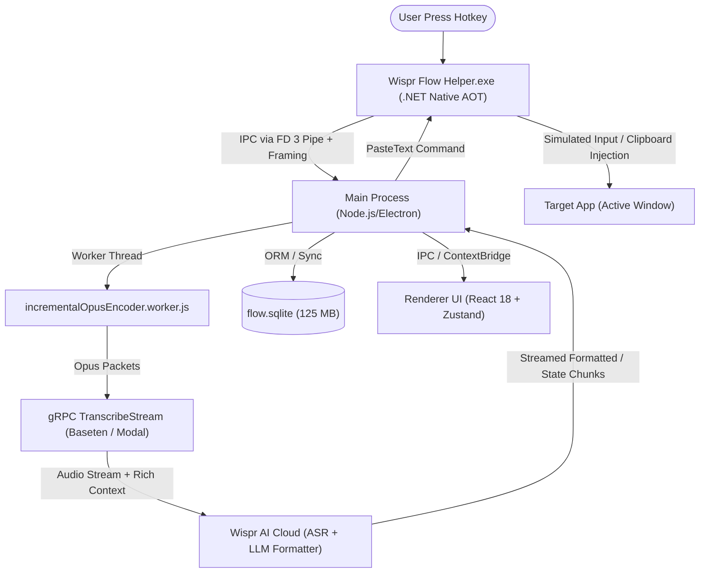

# Wispr Flow: Complete Reverse Engineering & Architecture Analysis

---

## 1. Executive Summary & Application Overview

* **Application Name:** Wispr Flow (Internal Name: `wispr-flow` / `flow`)
* **Product Version:** `1.6.1337` / `1.6.1376`
* **Architecture Type:** Electron Desktop Application with Native Windows Helper (`.NET Native AOT`)
* **Vendor / Organization:** Wispr AI (`https://wisprflow.ai`)
* **Executable Location:** `C:\Users\salim\AppData\Local\WisprFlow\Wispr Flow.exe`
* **App Bundle Directory:** `C:\Users\salim\AppData\Local\WisprFlow\app-1.6.1376\`
* **User Data & Database:** `C:\Users\salim\AppData\Roaming\Wispr Flow\`

---

## 2. Multi-Process Architecture & Process Model



Wispr Flow is partitioned into three cooperating execution domains:
1. **The Native Helper (`Wispr Flow Helper.exe`):**
   * Standalone Native AOT compiled binary (`resources/Release/Wispr Flow Helper.exe`, ~20.7 MB).
   * Bypasses Electron sandbox; handles low-level Windows UI Automation (UIA), global keyboard hooks, and simulated input injection.
2. **Electron Main Process (`.webpack/main/index.js`):**
   * Written in TypeScript, bundled with Webpack (~10.5 MB).
   * Manages lifecycle, audio worker threads, SQLite ORM, and gRPC streaming.
3. **Renderer Process (`.webpack/renderer/`):**
   * React 18, `@tanstack/react-query`, and `zustand` (v5.0.9).
   * Entry points include `overlay/index.js` (floating dictation HUD), `hub/index.js`, `meeting_recorder/index.js`, etc.

---

## 3. Native Helper IPC Protocol Specification (Exact Reverse Engineering)

### IPC Transport & Framing
* **Transport:** Spawned child process with 4 pipes: `stdio: ["pipe", "pipe", "pipe", "pipe"]`.
* **IPC Channel:** **File Descriptor 3 (`stdio[3]`)** is exclusively used for structured IPC. Standard `stdout` is reserved for non-IPC diagnostics.
* **Stream Framing:** Pipe-delimited messages with plus-escape encoding:
  * Delimiter: `|`
  * Escape Character: `+`
  * Escaping rule: `+` $\rightarrow$ `+1`, `|` $\rightarrow$ `+2`
  * Unescaping rule: `+2` $\rightarrow$ `|`, `+1` $\rightarrow$ `+`

### Complete Helper API Command Inventory (105 Methods)
Key operational commands extracted from the IPC mapping table:
* **Dictation & Insertion:** `DictationStart`, `DictationStop`, `PasteText`, `CancelPaste`, `PasteOutcome`, `PasteAnalytics`, `SimulateKeyPress`
* **Context & Focus Management:** `GetTextBoxInfo`, `TextBoxInfo`, `GetActiveAppInfo`, `ActiveAppInfo`, `StoreFocusedAppAndElement`, `FocusStoredAppAndElement`, `GetSelectedTextViaCopy`
* **Accessibility & Screen:** `SetAccessibilityTreeCapture`, `AccessibilityTreeHTML`, `SetInputEventCapture`, `InputEvent`, `UpdateEditedText`
* **Audio & Meeting Intelligence:** `GoogleMeetAudioDeviceChanged`, `GoogleMeetMicrophoneMuteChanged`, `ZoomMeetingAudioChanged`, `TeamsMeetingAudioChanged`, `GetSlackHuddleState`, `SlackHuddleState`, `MeetingSpeakerChange`

### `PasteText` Payload Structure
```typescript
interface PasteTextPayload {
  pasteId: string;              // UUID
  text: string;                 // Plaintext to inject
  htmlText?: string;            // Rich text / HTML alternative
  logAttributes?: object;
  captureKeystrokeTrace?: boolean;
}
```
* **Clipboard Preservation:** Wispr Flow captures existing clipboard text (`clipboard.readText()`) prior to paste dispatch, executes injection, and preserves history/undo stability.

---

## 4. Real-Time Audio Pipeline & Transport

* **Worker Architecture:** Audio compression executes off-thread in `incrementalOpusEncoder.worker.js`.
* **Opus Encoding:** Converts raw PCM stream into Opus packets incrementally using `opusscript` (WebAssembly libopus).
* **VAD & Visualizer:** Real-time FFT (`fft.js`) computes audio power frequency bins for animated waveform display and speech presence detection.
* **Hardware Integration:** Jabra SDK (`@gnaudio/jabra-js` and native companion) for push-to-talk headsets.

---

## 5. Cloud gRPC Inference Engine & Geo-Routing

### Cloud Infrastructure
* **Inference Hosts:**
  * Primary: `inference.wisprflow.com`
  * Baseten Model Cluster: `model-<id>.grpc.api.baseten.co:443`
  * Modal Serverless: `wispr-ai-prod--prod-grpc-server-flowgrpcserver.us-east.modal.direct`
  * Dynamic Endpoint Discovery: `https://inference-info.wisprflow.com/dictation_url.txt`

### Dynamic Geo-Latency Probing
* Fetches active replica model IDs from `AriaWebClient.getGrpcServerList()`.
* Measures TLS handshake latency to `model-${id}.grpc.api.baseten.co:443` in parallel.
* Dynamically routes to the lowest-latency GPU server; re-probes periodically every 10 minutes (`600,000 ms`).

### gRPC Service: `transcribeStream`
* **Request Structure:**
  ```typescript
  {
    payload: {
      audio: {
        oneofKind: "audioPackets",
        audioPackets: { items: Uint8Array[] }
      }
    },
    context: ContextObject,
    commit: boolean,  // true when user releases hotkey
    init: InitMetadataObject
  }
  ```

### Context Injection Schema (`getContext()`)
Wispr Flow provides rich contextual metadata to the backend LLM:
```typescript
interface ContextPayload {
  app: {
    name: string;        // e.g. "Code.exe", "slack.exe", "chrome.exe"
    bundleId: string;
    url?: string;        // Active browser tab URL
    type: AppType;
  };
  userIdentifier: string;
  vocabulary: {
    screenContentAx: string[];       // Accessibility tree extracted words
    screenContentOcr: string[];      // OCR words
    variableNames: string[];         // Active VS Code identifiers & variables!
    fileNames: string[];             // Open file names in IDE!
  };
  textbox: {
    contents: string;
    beforeText: string;              // Text before cursor
    selectedText: string;            // Currently selected text
    afterText: string;               // Text after cursor
  };
  contentText: string[];             // Surrounding UI text
  contentHtml: string;               // Accessibility HTML tree fragment
  screenshot?: Uint8Array;
}
```

### Dual Mode: Dictation vs AI Instruction
* If classified as `instructShortcut`, the model treats the audio as a command (e.g., "translate this to Spanish", "rewrite politely") rather than verbatim dictation.
* Audio lag monitoring triggers parallel HTTP fallback if gRPC lag exceeds safe thresholds.

---

## 6. Text Diffing & Divergence Verification

* **Low-Jitter Insertion:** Uses `diff-match-patch` and `diff-match-patch-line-and-word` to compute incremental edits between partial streamed transcripts, preventing cursor jitter.
* **Insertion Verification:** Traced in `logs/insertion-verification-debug.jsonl`.
* **Divergence Learning:** Monitors user backspacing or immediate edits post-paste (`edited-text-debug.jsonl`) to score transcription accuracy and continuously train local `Dictionary`.

---

## 7. Local Database Schema (`flow.sqlite`)

Stored at `%APPDATA%\Wispr Flow\flow.sqlite` (~125 MB) via Sequelize ORM:

| Table | Purpose | Notable Columns |
| :--- | :--- | :--- |
| `History` | Voice typing history | `transcriptEntityId`, `timestamp`, `app`, `url`, `asrText`, `formattedText`, `pastedText`, `toneMatchedText`, `e2e_latency`, `language`, `logprobs`, `opusChunks` (BLOB) |
| `Dictionary` | Custom vocabulary & replacements | `word`, `to_replace`, `frequency`, `source`, `sync_status` |
| `Meetings` | Recorded meetings & summaries | `meetingId`, `calendar_event_key`, `recorded_ms`, `candidate_summary`, `speaker_assignment_edits` |
| `Notes` & `SharedNotes` | Saved summaries & notes | `noteId`, `meetingId`, `content`, `share_key` |
| `Snippets` | Text expansion shortcuts | `trigger_phrase`, `expanded_text`, `usage_count` |
| `UsageOutbox` | Offline synchronization queue | `eventId`, `payload`, `needs_uploading` |

---

## 8. Binary Hardening & Fuses

* `RunAsNode`: Disabled
* `NodeCliInspectArguments`: Disabled
* `EmbeddedAsarIntegrityValidation`: Disabled
* `OnlyLoadAppFromAsar`: Disabled
* `WasmTrapHandlers`: Enabled (accelerates Opus Wasm DSP)
