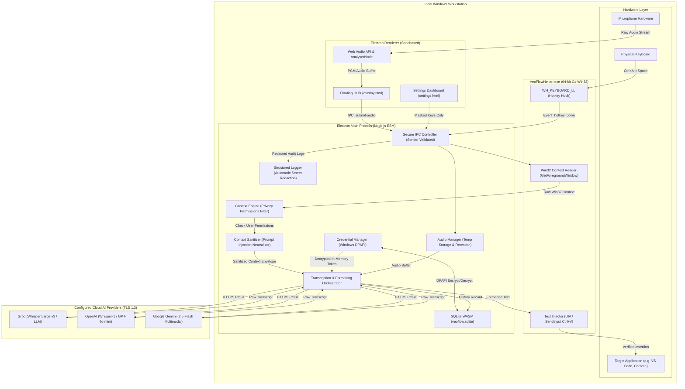

# VeoFlow: Privacy & Data Flow Architecture

**Document Version:** 1.0.0  
**Last Updated:** November 5, 2026  
**Security Practice:** Principle of Least Privilege & Data Minimization

---

## 1. High-Level Data Flow Architecture

The following diagram illustrates how user speech, target context, and credentials flow across VeoFlow subsystems. All external communication is strictly confined to the Electron Main process over encrypted TLS.

---

## 2. Privacy Boundaries & Invariants

| Boundary                          | Invariant / Enforcement                                                                                                                                                                         |
| :-------------------------------- | :---------------------------------------------------------------------------------------------------------------------------------------------------------------------------------------------- |
| **Outbound Cloud Network Egress** | ONLY speech audio buffers and sanitized target application metadata (`<untrusted_app_context>`) are transmitted to the user-selected AI provider over TLS 1.3.                                  |
| **Renderer Network Isolation**    | Renderer windows (`overlay.html`, `settings.html`) have `connect-src 'none'`. They are physically incapable of establishing HTTP/WebSocket connections.                                         |
| **Zero Screen Capture**           | Screenshots, OCR, display scrapes, and desktop recording are **strictly prohibited and completely absent** from both Electron and the native helper.                                            |
| **Credential Seclusion**          | Third-party API keys are encrypted at rest with Windows DPAPI. Decryption occurs only in main process memory when initiating API requests. Plaintext keys **never enter the renderer process**. |
| **Log Scrubbing**                 | Application logs in `~/.veoflow/logs/` are automatically scrubbed of all known API key patterns, Bearer tokens, and sensitive credential keys before hitting disk.                              |

---

## 3. Context Permission Defaults & User Controls

VeoFlow implements strict **Privacy by Default**:

| Context Property                         | Default State | Configurable In UI | Privacy Rationale                                                                                                |
| :--------------------------------------- | :-----------: | :----------------: | :--------------------------------------------------------------------------------------------------------------- |
| **Process Executable Name** (`appName`)  |  **Allowed**  |         No         | Required for basic application classification (e.g. `Code.exe` vs `Slack.exe`). Contains no user data.           |
| **Window Title** (`windowTitle`)         |  **Allowed**  |      **Yes**       | Helps distinguish document names or editor tabs. Can be completely disabled by the user in Settings.             |
| **Browser URL** (`url`)                  | **DISABLED**  |  **Yes (Opt-in)**  | Browsing URLs may contain tracking parameters, tokens, or sensitive internal paths. User must explicitly opt in. |
| **Selected Text** (`selectedText`)       | **DISABLED**  |  **Yes (Opt-in)**  | Selected text in other applications could contain passwords or confidential data. Strictly opt-in.               |
| **Surrounding Text** (`surroundingText`) | **DISABLED**  |  **Yes (Opt-in)**  | Textbox surrounding content is bounded and strictly opt-in.                                                      |
| **Screenshots / Visuals**                |   **NEVER**   |       **No**       | Zero capability in codebase.                                                                                     |

---

## 4. Local Data Retention & Lifecycle Management

### A. Spoken Audio Buffers (`~/.veoflow/recordings/`)

- Temporary audio files (`recording_<timestamp>_<id>.wav`) are stored locally to permit transcription retries and debugging.
- **Automatic Rotation:** Every new recording triggers `cleanupOldRecordings()`, which deletes all audio files older than **24 hours** or exceeding the **50-file ceiling**.
- **Instant Wipe:** Clicking "Clear all history" in the Settings Dashboard immediately deletes all temporary audio files from disk.

### B. SQLite Database (`~/.veoflow/veoflow.sqlite`)

- Dictation history (transcripts, timestamps, latency, status) is stored locally in SQLite.
- **Configurable Retention Policy:** Users can select 7 days, 30 days, 90 days, 365 days, or indefinite (`0`). Records older than the cutoff are automatically purged upon application startup.
- **Single-Item Deletion:** Users can delete individual history entries at any time.

### C. Clipboard Restoration & Safety

- When using clipboard fallback insertion, VeoFlow snapshots the clipboard before paste.
- After target application consumption (250ms), VeoFlow verifies whether the clipboard still contains the temporary payload.
- If unchanged, the original clipboard content is restored.
- If the user or another process copied new data during the paste window, VeoFlow **preserves the external data** and aborts restoration to avoid overwriting user clipboard modifications.
